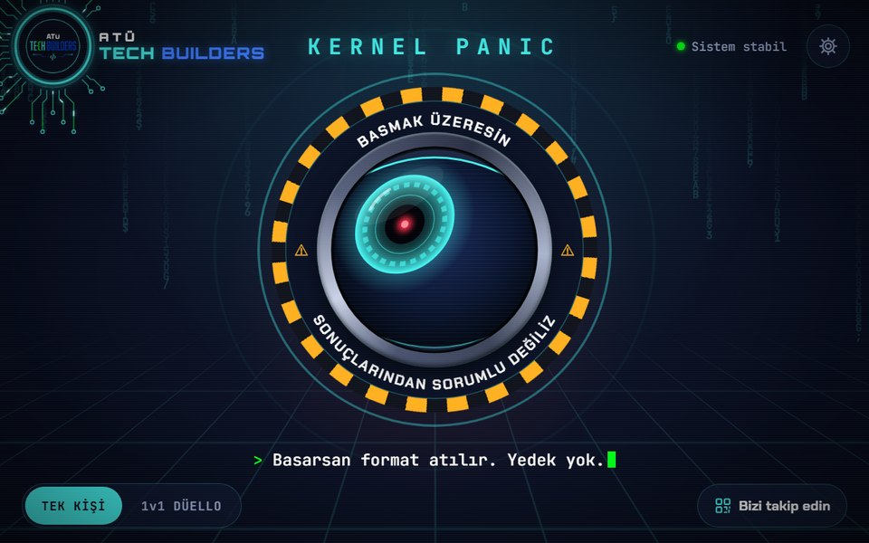
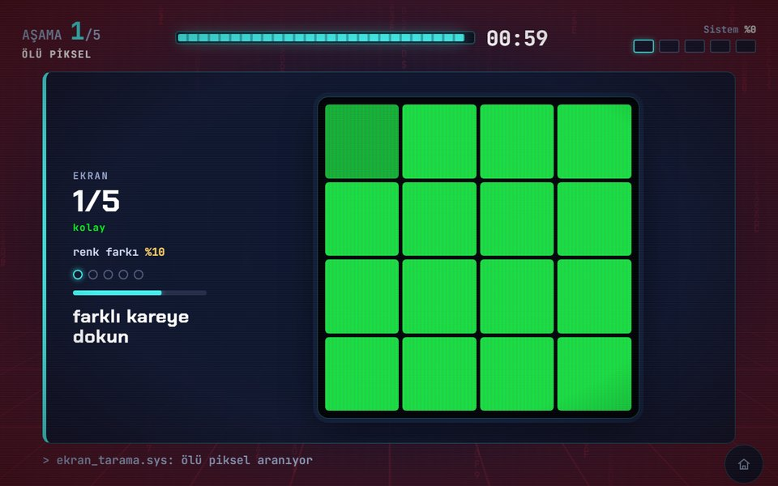
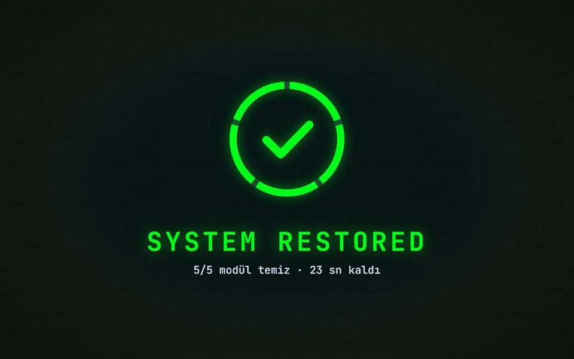
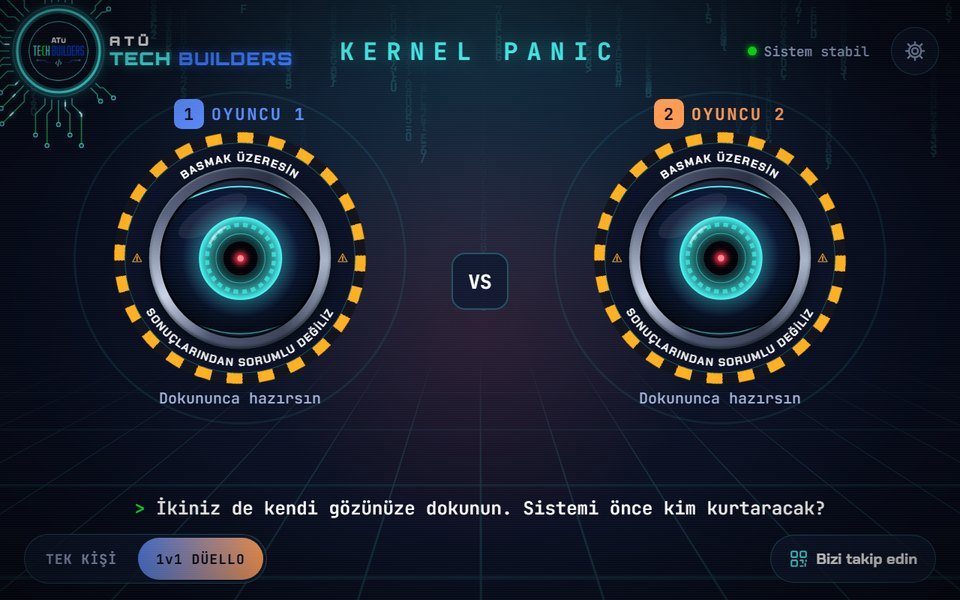
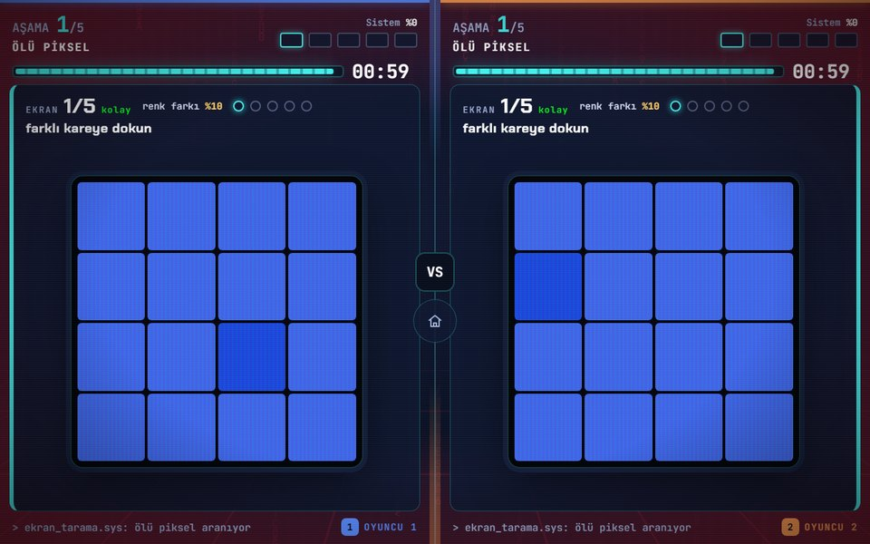

# KERNEL PANIC

**Booth game #2 of [ATÜ TechBuilders](https://linktr.ee/atutechbuilders)** — _"Basma dedik. Bastın."_ (We said don't press. You pressed.)

[](https://github.com/TechBuildersATU/KernelPanic/actions/workflows/ci.yml)


A cyber eye stares at you from a hazard ring: _"You are about to press. We are not responsible for
the consequences."_ Press it and the system gets hacked. You have **60 seconds** to save it in
**five small games**, alone or **1 v 1** on a split screen. No leaderboard, no names, no network:
a tablet game for a busy university booth, built to be understood in three seconds by people
who have never written a line of code.



The game itself speaks Turkish (it was made for a Turkish university booth); the code and the
documents are in English. A [Turkish section on how to play](#türkçe-oyun-nasıl-oynanır) closes
this page.

## Contents

- [How a round goes](#how-a-round-goes)
- [The five stages](#the-five-stages)
- [Surprise events](#surprise-events)
- [Grades and titles](#grades-and-titles)
- [1 v 1 duel](#1-v-1-duel)
- [Built for a booth](#built-for-a-booth)
- [Running it](#running-it)
- [Android APK](#android-apk)
- [Tests](#tests)
- [Project structure](#project-structure)
- [Documents](#documents)
- [License](#license)
- [Türkçe: Oyun nasıl oynanır](#türkçe-oyun-nasıl-oynanır)

## How a round goes

1. **The eye.** It looks somewhere else every 3 seconds and wherever you touch the screen. When
   nobody has touched it for a while it turns to you, squints and blinks twice.
2. **The hack.** Press it: the eye opens wide and turns red, the room fills with red light,
   _SYSTEM FAILURE_ glitches onto the screen and a 3-2-1 countdown starts.
3. **Five stages** in a fixed order. Each one is a small game that gets harder step by step, and
   every step has its own timer. A mistake never ends a stage: it only costs that step, the right
   answer is shown and the next step comes.
4. **The grade.** Every stage ends with a colour grade from its share of right steps.
5. **The ending.** The five grades decide a **title**, which gets its own animation (a restore
   ring, a magnifying glass finding the one bug, an old boot menu picking Safe Mode, the kernel's
   last words …), then the result and, if you want, an **error report** of every wrong step.

The round clock only runs while you play: it stands still while you watch a sequence, read a
title card or an event. When it runs out the round does not stop; the clock turns red and counts
on, and you get one of the "late" titles.



## The five stages

| #   | Stage                                      | What you do                                                                                                                           | Steps                                                              |
| --- | ------------------------------------------ | ------------------------------------------------------------------------------------------------------------------------------------- | ------------------------------------------------------------------ |
| 1   | **Dead Pixel** _(Ölü Piksel)_              | Find the square with a slightly different colour, on a different kind of panel each time (LCD, LED, diamond, honeycomb, RGB bars)     | 5 screens: 4×4 → 8×8, the difference shrinks from 10 % to 3.5 %    |
| 2   | **Four Colours** _(Dört Renk)_             | Watch the pads light up, then repeat the order                                                                                        | 3 layers: 3 colours slow → 5 fast → 5 with the pads trading places |
| 3   | **Beam Path** _(Işın Yolu)_                | Tap mirrors so the laser reaches the server; the beam can come from either side                                                       | 3 lines with more mirrors, decoys and walls                        |
| 4   | **Colour Trap** _(Renk Tuzağı)_            | A colour name written in another colour: first tap what it _says_, then the rule flips and you tap its _ink_                          | 6 words                                                            |
| 5   | **Don't Press** _(Basma Dedik)_, the final | One red button. Hold it, press it three times, press on green, don't touch it … then **reverse mode** flips "press" and "don't press" | 6 commands                                                         |

No stage depends on sound, so the game works at a noisy booth.

## Surprise events

Never on the first stage or the final, at most two a round:

- **SYSTEM OVERHEAT!** depends on how you play. Too fast: a "DON'T TOUCH!" cooling where touching
  costs 5 s. Too slow: keeping your hands off gives you 5 s back.
- **GLITCH DETECTED!** comes once every round and breaks a stage a little: pads swap again, a
  mirror turns by itself, colour buttons move after every answer. The logic never breaks, only
  places change.
- **POWER RESTORED!** two good stages in a row turn the red alarm into a calmer orange.

## Grades and titles

| Share of right steps | Grade                             |
| -------------------- | --------------------------------- |
| 100 %                | 🟩 green _(TEMİZ, clean)_         |
| over 75 %            | 🟨 lime _(İYİ, good)_             |
| 50–75 %              | 🟧 orange _(SINIRDA, borderline)_ |
| under 50 %           | 🟥 red _(BOZUK, broken)_          |

Ten titles come from the five grades: **SYSTEM SAVIOR**, **LAST SECOND HERO**, **ALL SYSTEMS GO**,
**ONE BUG LEFT**, **BARELY BOOTED**, **SAFE MODE**, **ERROR 404**, **KERNEL PANIC**, and for the
late ones **ALMOST A LEGEND** and **HAVE YOU TRIED TURNING IT OFF AND ON?**



## 1 v 1 duel

Switch to **1v1 DÜELLO** and two eyes look around together. Each player presses their own; the
round starts once both have. Both players get the same stages at the **same difficulty with
different answers** (the dead pixel elsewhere, other colour orders, other words, another command
order; Beam Path is identical for fairness), so looking at the other half does not help. Each
half takes only its own touches. The one who finishes first gets their ending on their own half
and waits; the higher share of the system saved wins, then the time left.

| The duel's button screen                                    | The split screen                                         |
| ----------------------------------------------------------- | -------------------------------------------------------- |
|  |  |

## Built for a booth

- **Fully offline:** a PWA and an Android APK; no API, no server, no data about the player.
- **Kiosk:** 1280×800 landscape stage scaled to any screen, no zoom, scrolling or long-press
  menus, the screen kept awake, Android's back button ignored, idle screens go back to the eye
  after 25 s.
- **One world:** every screen stands in the same room (code rain, a grid floor, a light that
  changes with the mood) and screens cross-fade with View Transitions; animations are soft and
  grow out of something on screen.
- **Sound** is synthesised with Web Audio: effects and generative music per scene, no audio
  files. Every cue also shows on screen.
- **Photosensitive safety:** nothing flashes more than three times a second; the device's
  reduced-motion setting is respected.
- **Tunable in one file:** round length, step timers, grade thresholds and event odds live in
  [`src/game/config.ts`](src/game/config.ts).

## Running it

Requirements: Node.js 22 and npm.

```bash
npm install
npm run dev          # http://localhost:5174
npm run dev:tablet   # the same, reachable from a tablet on the local network
```

Useful URL flags in development (test builds only):

| Flag                       | Effect                                                                         |
| -------------------------- | ------------------------------------------------------------------------------ |
| `?seed=4`                  | A fixed round: the same screens and events every time                          |
| `?fastTimers=1`            | Short animation waits (never the round clock or the step timers)               |
| `?event=glitch`            | Force an event: `glitch`, `power`, `overheat-fast`, `overheat-slow`, or `none` |
| `?transition=one-bug-left` | Loop one title's ending (`&half=1`: inside a duel half)                        |
| `?intro=1`                 | Play the APK's opening in the browser                                          |

The settings (the gear, top right) hold only the round length (45 / 60 / 75 s) and sound.

## Android APK

```bash
npm run apk          # → dist-apk/KernelPanic-<version>-debug.apk
```

`scripts/build-apk.mjs` builds the web app, syncs it into the Capacitor project in `android/` and
runs Gradle. It finds the Android SDK at `%LOCALAPPDATA%/Android/Sdk` and a JDK 17–21 from
Android Studio (or set `ANDROID_HOME` / `JAVA_HOME`). The app runs landscape and full screen,
keeps the screen on, never exits on the back button and opens with a short animated intro.

## Tests

```bash
npm test             # unit tests (Vitest)
npm run e2e          # end-to-end tests (Playwright, a 1280×800 touch tablet + the offline PWA)
npm run check        # lint → typecheck → unit → build → e2e, the same steps as CI
```

- **Unit tests** cover the pure rules: grades and titles, event triggers, the stage generators
  (every beam line is solvable, the duel players get different answers at the same difficulty),
  the stage runners with fake timers, the eye's geometry.
- **End-to-end tests** press every button on the tablet profile: the whole booth loop, every
  stage, every event (forced with URL flags), every title's ending, the duel, the eye's looks,
  the offline launch. Any console error fails a test.
- Timed checks never race the game's clocks: they hold the page's clock or act inside the page,
  so they pass on slow CI machines too.

## Project structure

```
src/
  app/              storage, test flags, timing, screen switches, kiosk
  components/       the stage, header, logo chip, dialogs; eye/ (the button screen's eye)
  game/             the round as a pure state machine, config, grades, titles, events, duel
  game/stages/      the five stages' seeded generators + per-player content for the duel
  screens/          Attract, Hack, Play, Result, Report, Settings, DuelPlay, DuelResult
  screens/stages/   the five games (PixelStage … OrdersStage) + runners/ (their timed logic)
  fx/               the shared world, code rain, result transitions, the APK's opening
  audio/            synthesised effects and music
  data/             the Turkish on-screen texts
tests/unit/         Vitest          e2e/          Playwright
android/            the Capacitor project       scripts/      the APK build
docs/               roadmap and design document, sketches, screenshots, archive
```

Stack: React 19, TypeScript 6, Vite 8, CSS Modules, vite-plugin-pwa, Capacitor 8, Vitest,
Playwright, oxlint and Prettier.

## Documents

- [`docs/ROADMAP.md`](docs/ROADMAP.md) — the roadmap and design document: every screen, stage,
  event, grade, title and transition, the phase plan and the decision log
  ([PDF](docs/ROADMAP.pdf)).
- [`AGENTS.md`](AGENTS.md) — the rules for coding agents (and humans) working on the code.
- [`docs/sketches/`](docs/sketches) — the club's first sketches.
- [`docs/archive/`](docs/archive) — the quiz the game started as.

## License

The code is released under the [MIT License](LICENSE). The ATÜ TechBuilders name and logo, the
icons and launch images made from it, the club's Linktree QR code and the documents in `docs/`
are not covered by it; all rights reserved by ATÜ TechBuilders.

Made by **ATÜ TechBuilders** for the club's booth on 4 November 2026, next to its first booth
game, [BuildArena](https://github.com/TechBuildersATU/BuildArena).

---

## Türkçe: Oyun nasıl oynanır

**KERNEL PANIC**, ATÜ TechBuilders'ın ikinci stant oyunu. Kodlama bilmeyen biri de üç saniyede
anlasın diye tasarlandı: tablet, dokunmatik, tamamen çevrimdışı. Skor tablosu yok, isim girilmez,
oyuncu hakkında hiçbir şey kaydedilmez.

### Mantığı

Ekranda sarı-siyah bir uyarı halkasının içinde siber bir göz var; etrafında **"BASMAK ÜZERESİN.
SONUÇLARINDAN SORUMLU DEĞİLİZ."** yazıyor. Göz her 3 saniyede bir başka yöne bakar, ekranın
neresine dokunursan oraya döner; kimse dokunmazsa sana dönüp gözünü kısar. Göze basınca sistem
"hacklenir" ve sistemi kurtarmak için **60 saniyen** olur. Kurtarmak için beş küçük oyunu sırayla
oynarsın. Süre yalnızca sen oynarken akar: başlık kartında, renkleri izlerken ya da bir olayda
durur. Süre biterse tur kesilmez; sayaç kırmızıya döner ve ileri sayar.

### Nasıl oynanır

1. **Göze bas.** Göz irileşir ve kırmızıya döner, "SYSTEM FAILURE" yazar, 3-2-1 geri sayım başlar.
2. **Beş aşamayı oyna.** Her aşamanın başında büyük bir komut ve tek satır ipucu çıkar. Her adımın
   kendi süresi vardır. Yanlış yaparsan ya da süre biterse yalnızca o adımı kaybedersin, doğrusu
   gösterilir ve sıradaki adım gelir; aşama her zaman sonuna kadar oynanır.
   1. **Ölü Piksel:** rengi azıcık farklı kareyi bul. 5 ekran, her ekranda kareler çoğalır ve fark
      azalır; her ekran başka bir panel (LCD, LED, elmas, petek, RGB) ve başka bir renk. Yanlış
      kare o ekranın süresinden 2 sn götürür.
   2. **Dört Renk:** yanan renkleri izle, aynı sırayla tekrarla. 3 katman; son katmanda gösterimden
      sonra renk tuşları yer değiştirir.
   3. **Işın Yolu:** aynalara dokunup çevir, ışın sunucuya ulaşsın. 3 hat, her hatta daha çok ayna;
      ışın bazen soldan, bazen sağdan gelir, sunucu her yerde olabilir.
   4. **Renk Tuzağı:** bir renk adı başka renkte yazılır. Önce **yazısına** bas; "KURAL DEĞİŞTİ"
      uyarısından sonra **rengine** bas.
   5. **Basma Dedik (final):** tek kumanda kırmızı buton. BASILI TUT, 3 KEZ BAS, YEŞİLDE BAS,
      BASMA! … ve son adımda **TERS MOD**: "BAS" yazınca basma, "BASMA!" yazınca bas.
3. **Notunu al.** Her aşama doğruların oranına göre renk alır: %100 yeşil (TEMİZ), %75'in üstü açık
   yeşil (İYİ), %50–75 turuncu (SINIRDA), %50'nin altı kırmızı (BOZUK).
4. **Ünvanını gör.** Beş not bir ünvan belirler (SYSTEM SAVIOR, ONE BUG LEFT, SAFE MODE, KERNEL
   PANIC …); her ünvanın kendi animasyonu vardır. İstersen **hata raporunu** açıp hangi adımda
   neyi yanlış yaptığını görürsün. 25 sn dokunulmazsa oyun başa döner.

### Sürprizler

İlk ve son aşamada olay gelmez, bir turda en fazla iki olay olur:

- **SYSTEM OVERHEAT!** Çok hızlıysan ekran "DOKUNMA!" der; dokunursan 5 sn kaybedersin. Çok
  yavaşsan dokunmadan beklersen 5 sn kazanırsın.
- **GLITCH DETECTED!** Her turda bir kez gelir, bir aşama biraz bozulur: tuşlar yine yer
  değiştirir, bir ayna kendi kendine döner, renk düğmeleri her cevaptan sonra kayar.
- **POWER RESTORED!** Art arda iki iyi aşama kırmızı alarmı sakin bir turuncuya çevirir.

### 1v1 Düello

Ekranın altından **1v1 DÜELLO**'yu seç; iki göz birlikte etrafa bakar. İki oyuncu da kendi gözüne
basınca tur başlar (biri basıp diğeri 12 sn basmazsa gözler bırakır). Ekran ikiye bölünür, iki
oyuncu aynı beş aşamayı aynı zorlukta ama **farklı cevaplarla** oynar: yan tarafa bakmak işe
yaramaz (Işın Yolu adil olsun diye ikisinde aynıdır). Önce biten oyuncu kendi yarısında sonucunu
görür ve bekler. Sistemi daha çok kurtaran kazanır; eşitse süresi çok kalan.

### Görevliler için

- Ayarlar sağ üstteki dişlidedir: yalnızca tur süresi (45 / 60 / 75 sn) ve ses.
- Oyun içinde sağ alttaki ev düğmesini **1 saniye basılı tutmak** turu bırakıp ana ekrana döner.
- "Bizi takip edin" düğmesi kulübün Linktree QR kodunu açar.
- Logoya art arda 5 kez dokunmak küçük bir sürpriz gösterir.
